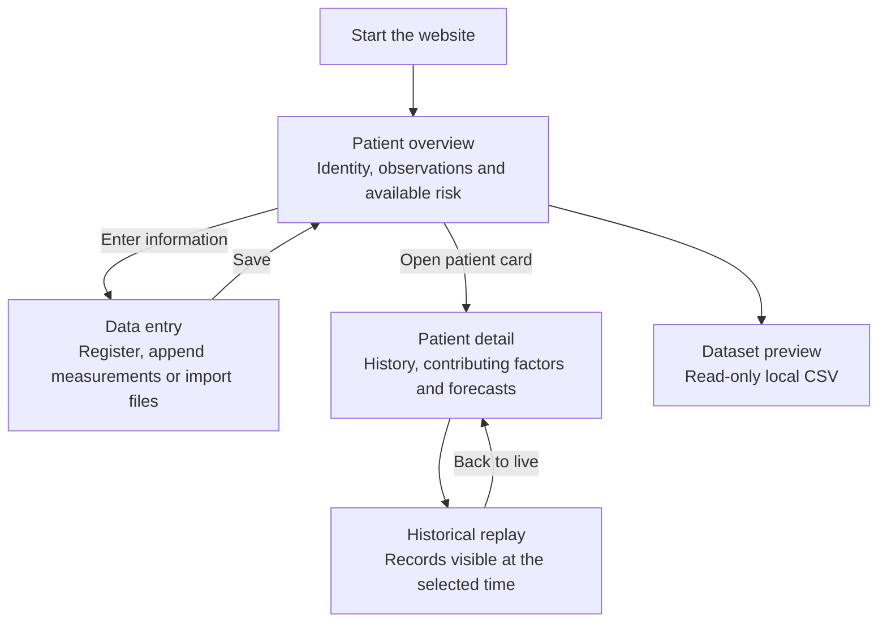
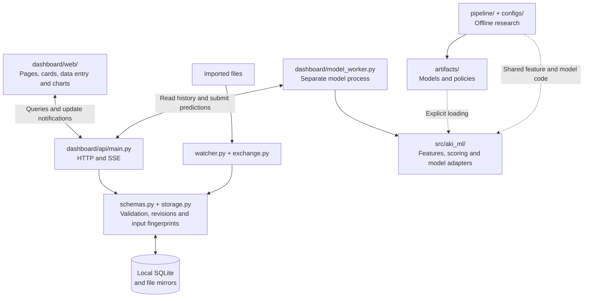

# AI for Health - Dynamic AKI Early Warning

This project develops a reproducible, local-only dynamic acute kidney injury (AKI) early-warning research pipeline and an ICU-facing course-project website. It is a research and decision-support prototype, not a treatment recommendation or validated clinical product.

Notebooks 01 and 02 and the Demo I evaluation are implemented and have been run on local MIMIC-III v1.4; the locked test-set evaluation (notebook 03) has not been done yet. The sections below describe the study design; results so far are under [Current status](#current-status). The design does not restrict the website to fixed sampling intervals or prediction horizons.

## Documentation

| Document | Scope |
|---|---|
| This README | Research objective, candidate study design, notebook ownership, privacy, and repository-wide status |
| [pipeline/RESEARCH.md](pipeline/RESEARCH.md) | Offline extension definitions, modules, baseline runs, target extraction and artifact interfaces |
| [handoff/README.md](handoff/README.md) | Local handoff restoration, validation-only inputs, team task notebooks and reproduction limits |
| [handoff/KEJIN-EVALUATION.md](handoff/KEJIN-EVALUATION.md) | Artifact audit, validation-role alert selection, cutoff controls and candidate confirmation |
| [dashboard/README.md](dashboard/README.md) | Website installation, startup, daily use, and local CSV preview |
| [dashboard/DEVELOPMENT.md](dashboard/DEVELOPMENT.md) | Website architecture, backend/model integration, and development workflow |
| [dashboard/DATA-CONTRACT.md](dashboard/DATA-CONTRACT.md) | Normative live JSON field and time contract |
| [dashboard/VALIDATION.md](dashboard/VALIDATION.md) | Tests actually run and their limits |
| [dashboard/HANDOFF-CHECK.md](dashboard/HANDOFF-CHECK.md) | Historical comparison between the handoff summary and repository |
| [artifacts/README.md](artifacts/README.md) | Local artifacts, required model files, and the committed aggregate alert policy |
| [filter/README.md](filter/README.md) | Separate local CSV/TSV cleaning tool |

## Website at a glance

### User workflow



New inputs update observations; eligible predictions are recalculated by the configured model. Historical replay queries saved records without running inference. See [website operation](dashboard/README.md) for startup modes and daily use.

### Code and data flow



Runtime components run on the local computer. SSE sends revision notifications, after which the browser queries updated data. The file watcher imports into storage; the model worker reads and submits through HTTP. Detailed boundaries are in [DEVELOPMENT.md](dashboard/DEVELOPMENT.md), field rules in [DATA-CONTRACT.md](dashboard/DATA-CONTRACT.md), and offline experiments in [pipeline/RESEARCH.md](pipeline/RESEARCH.md).

## Core pipeline

```text
Local MIMIC-III tables
-> validated identifiers and deterministic one-stay-per-patient cohort
-> assign dataset-local patient_id/stay_id after cohort selection
-> patient-level development split manifest (before snapshots)
-> timestamped KDIGO AKI onset
-> hourly prediction snapshots
-> leakage-safe multimodal features
-> fixed train / validation / test assignment inherited by every snapshot
-> pooled LR, RF, and boosted-tree model families
-> 6h / 12h / 24h / 48h AKI risks
-> validation-selected model, monitoring window, threshold, and alert policy
-> locked test evaluation at snapshot, patient, and AKI-event levels
-> event-driven dashboard and robustness analyses
```

## Prediction design

- Population: adults, one deterministically selected eligible ICU stay per patient, sufficient follow-up, and prespecified ESKD/dialysis exclusions.
- Identity: `subject_id` is the source patient key; `hadm_id` is the hospital admission key; `icustay_id` is the ICU-stay key. After cohort selection, create dataset-local `patient_id` and `stay_id` keys with one-to-one mappings to the selected source IDs.
- Sampling: one training snapshot per ICU hour during the eligible monitoring period.
- Prediction targets: AKI within 6, 12, 24, and 48 hours; the operational horizon is selected on validation data.
- Reporting checkpoints: 6, 12, 24, and 48 hours after ICU admission, without training separate checkpoint-specific models.
- Primary label: creatinine-based KDIGO only. Retain urine-output KDIGO 2012 as a separate alternative endpoint for robustness testing, using prespecified weight, rolling-window, missing-output, and renal-replacement-therapy rules.
- AKI timing: notebooks 01-03 keep creatinine-based onset as the primary task and urine-output onset as a separate endpoint. Notebook 04 implements an independent combined observed-onset development experiment; it does not replace the primary study.
- Model families: Logistic Regression, Random Forest, and boosted trees (LightGBM as the prespecified primary implementation, XGBoost as a comparator), compared independently. Model settings live in `configs/ml.yaml`.
- Deployment simulation: replay timestamped raw EHR events, recompute the current feature state and risk whenever a relevant event arrives, and keep fitted weights fixed during prediction.

Each model-family pipeline contains horizon-specific output heads for 6h, 12h, 24h, and 48h. This keeps one reproducible pipeline per family while allowing each horizon to be calibrated and evaluated correctly.

## Temporal rules

For every snapshot and horizon:

```text
feature_time <= snapshot_time
label_window = (snapshot_time, snapshot_time + horizon]
```

- Stop generating snapshots at AKI onset, ICU discharge, or the configured monitoring endpoint.
- For each snapshot and horizon, require observable follow-up through the horizon or an observed AKI event; if ICU discharge or another censoring boundary occurs first, mark that horizon ineligible rather than assigning a negative label.
- Apply configured minimum observation/measurement coverage rules separately from outcome eligibility; insufficient data coverage must not be silently treated as a negative outcome.
- Post-snapshot urine may define a future outcome but must never enter the current feature vector.
- Overlapping hourly labels are expected; all snapshots from one patient must remain in one split.
- The unique-stay selection and patient split manifest are frozen before snapshots, labels, or features are generated. A later table join must never re-select a stay using outcome information.
- Imputation, scaling, feature selection, weighting, calibration, and tuning must not use test information.

## Data split and model selection

- First select exactly one eligible ICU stay per patient using a prespecified rule based only on cohort eligibility and source chronology (for example, the earliest eligible ICU stay). Do not choose a stay using AKI outcome, feature completeness, or model performance.
- After cohort selection, create one dataset-local `patient_id` per included `subject_id` and one `stay_id` per selected `icustay_id`; record the crosswalk before splitting.
- Create one reproducible row per patient in the split manifest: `patient_id`, source `subject_id`, selected `icustay_id`, and `split`.
- Generate snapshots, labels, and features only from the selected stay. Every row derived from that patient inherits the manifest assignment.
- Never randomly split snapshot rows or independently split `hadm_id`/`icustay_id` rows after snapshot generation.
- Process large MIMIC event tables in chunks or stay-level partitions and preserve identifiers, timestamps, units, and provenance before aggregation.

- Train: fit preprocessing and models; use patient-grouped internal cross-validation for hyperparameters when needed.
- Validation: compare model families, inspect calibration and predictor stability, select the monitoring window, horizon, threshold, and alert policy.
- Test: evaluate the completely locked system once.

Candidate horizons, time segments, and policies should be limited and prespecified to reduce validation overfitting. MIMIC-III dates are shifted independently by patient, so shifted calendar years must not be treated as true chronology. CareVue versus MetaVision can be evaluated as a system-era robustness analysis; external validation on another approved local database is a later extension.

## Evaluation

Snapshot-level evaluation includes AUROC, AUPRC, sensitivity, specificity, F1, Brier score, and calibration curves. Operational evaluation must also report patient/event-level detection rate, first-warning lead time, false alerts per patient-day, repeat-alert burden, and the proportion of patients alerted without future AKI.

Subgroup and robustness analyses include age, sex, ICU type, CareVue versus MetaVision, baseline-creatinine definitions, creatinine-only versus creatinine plus urine-output KDIGO 2012, feature-window choices, missingness handling, and urine-output measurement/weight sensitivity.

## Independent development extensions

Notebooks 04 and 05 now provide modular combined-label classification and future-creatinine trajectory baselines. Notebook 03 has a shared executable development-evaluation path. These use explicit synthetic fixtures by default; real-data results and final test evaluation remain pending. Definitions and run commands are maintained in [pipeline/RESEARCH.md](pipeline/RESEARCH.md).

## Notebook ownership

| Notebook | Owner responsibility |
|---|---|
| `pipeline/01_dataset_construction.ipynb` | Source validation, ID crosswalk, one-stay-per-patient cohort, pre-snapshot patient splits, KDIGO timelines, hourly snapshots, multi-horizon labels, and features |
| `pipeline/02_ml_pipeline.ipynb` | Preprocessing, patient weighting, pooled LR, RF, LightGBM (primary) and XGBoost pipelines with 6h/12h/24h/48h heads, a LightGBM ablation without discharge-coded diagnoses (`no_dc`), Platt and isotonic calibration, and hourly plus event-driven risk outputs |
| `pipeline/demo_i_evaluation.ipynb` | Demo I: monitoring window, alert policy, and threshold selected on training out-of-fold predictions and confirmed once on validation; writes the locked policy used by the website |
| `pipeline/03_evaluation_and_testing.ipynb` | Executable small-baseline validation/threshold/cutoff path; full locked-test, subgroup, robustness and interpretation study remains pending |
| `pipeline/04_combined_aki.ipynb` | Independent combined observed-onset labels, grouped LR baseline, validation threshold and cutoff comparisons |
| `pipeline/05_trajectory_prediction.ipynb` | Actual future-creatinine targets, density audit, persistence/ridge baselines and cutoff comparisons |
| `pipeline/KeJin_alert_policy_and_checks.ipynb` | Completed A1–A12 and frozen-model validation-role policy experiment; 23%/12h candidate did not meet confirmation PPV floor and remains inactive |
| `pipeline/Jiaju_stability.ipynb` | Imported calibration/predictor/risk-stability scaffold; setup and Part 0 reproduced, later tasks pending |

Notebooks exchange versioned local Parquet artifacts rather than in-memory variables. Code shared by notebooks and the website lives in `src/aki_ml/`.

## Research artifact contracts

| Producer | Local output | Unit of observation |
|---|---|---|
| Dataset notebook | `<output_root>/datasets/cohort.parquet` | One selected ICU stay per patient, with source IDs and dataset-local patient ID |
| Dataset notebook | `<output_root>/datasets/snapshot_dataset.parquet` | One ICU stay and hourly snapshot, with horizon-specific labels and eligibility flags |
| Dataset notebook | `<output_root>/splits/patient_split.parquet` | One patient and its selected ICU stay, assigned before snapshots |
| Dataset notebook | `<output_root>/datasets/feature_dictionary.csv` | One column of the snapshot dataset, with role (feature, label, eligibility, identifier, ...), unit, window, and source |
| Dataset notebook | `<output_root>/datasets/event_stream.parquet` | One timestamped model-input event of a modeled stay, for event-driven replay |
| Dataset notebook | `<output_root>/dataset_manifest.json`, `<output_root>/reports/` | Provenance (config hash, commit, file hashes) and aggregate quality reports |
| ML notebook | `artifacts/models/<run_id>/` | One fitted model-family pipeline |
| ML notebook | `artifacts/predictions/<run_id>.parquet` | One model, ICU stay, snapshot, and horizon |
| ML notebook | `artifacts/predictions/<run_id>_event_replay.parquet` | One model, validation stay, event time, and horizon |
| Demo I notebook | `artifacts/demo_i/policy.json` and aggregate tables/figures | Locked alert policy (threshold, monitoring window, model hashes) and validation summaries |
| Original final evaluation (planned) | `artifacts/reports/<run_id>/` | Aggregate metrics and figures |
| Development notebooks 03/04/05 | `artifacts/extensions/<run_id>-<timestamp>/` | Independent model, manifest, aggregate validation/stability report and optional classification policy |

For the dataset notebook, `<output_root>` is `paths.output_root` in `configs/default.yaml` (default `../Cleaned`, outside the repository); filtered source caches go to `artifacts/interim/`. Only `artifacts/demo_i/policy.json` (the locked alert policy) is committed from `artifacts/`; see [artifacts/README.md](artifacts/README.md). These planned Parquet and experiment artifacts are separate from the website's live JSON exchange contract. The live contract is defined only in [dashboard/DATA-CONTRACT.md](dashboard/DATA-CONTRACT.md).

## Repository layout

<details>

<summary>Expand repository files</summary>

```text
.
|-- README.md
|-- pyproject.toml
|-- .gitignore
|-- .env.example
|-- configs/
|   |-- default.yaml           # dataset study design (notebook 01)
|   |-- ml.yaml                # model training settings (notebook 02)
|   |-- combined_aki.yaml      # independent union-label baseline
|   `-- trajectory.yaml        # observed-value trajectory baseline
|-- pipeline/
|   |-- 01_dataset_construction.ipynb
|   |-- 02_ml_pipeline.ipynb
|   |-- 03_evaluation_and_testing.ipynb
|   |-- demo_i_evaluation.ipynb
|   |-- 04_combined_aki.ipynb
|   |-- 05_trajectory_prediction.ipynb
|   |-- KeJin_alert_policy_and_checks.ipynb
|   |-- Jiaju_stability.ipynb
|   `-- RESEARCH.md            # offline extension definitions and workflow
|-- src/aki_ml/                # shared code: feature engine, model containers, alerts, scoring
|-- src/aki_eval/              # independent artifact checks, alert events and validation protocol
|-- tests/                    # synthetic evaluation and protocol tests
|-- dashboard/
|   |-- app.py                 # preserved original placeholder
|   |-- launcher.py            # starts the website and the model worker
|   |-- model_worker.py        # live scoring with the selected model adapter
|   |-- README.md              # website operation
|   |-- DEVELOPMENT.md         # developer and backend integration guide
|   |-- DATA-CONTRACT.md       # live JSON contract
|   |-- api/                   # FastAPI, SQLite, file ingestion, demo playback
|   |-- web/                   # React and TypeScript frontend
|   `-- tests/                 # synthetic backend tests
|-- handoff/                   # team handoff and evaluation guides/dependencies
|-- scripts/                   # setup, synthetic demo patients, batch scoring, demo upload
|-- filter/                    # separately added CSV/TSV cleaning tool
|-- Setup-AKI.cmd
|-- Start-AKI.cmd
|-- Start-AKI-Demo.cmd         # demo playback with synthetic patients
`-- artifacts/
    `-- README.md              # artifact inventory; policy.json is the committed exception
```

</details>

## Data and privacy

- Process MIMIC data only on approved local storage.
- Never upload patient-level data to OpenAI APIs or other third parties.
- Never commit raw data, derived patient records, predictions, SHAP records, or model weights.
- Commit only code, configuration, documentation, aggregate results, and verified non-identifying figures.
- A shareable dashboard must use synthetic data.

## Collaboration rules

- One owner per notebook; use scoped branches and pull requests.
- Agree on schemas before changing a producer notebook.
- Run a notebook from a clean kernel before merging and remove patient-level or large cell outputs.
- Record configuration, random seeds, package versions, dataset version, and Git commit for every experiment.

## Method references

- Tomašev et al., continuous AKI risk prediction up to 48 hours: https://doi.org/10.1038/s41586-019-1390-1
- Koyner et al., longitudinal 24-hour and 48-hour AKI prediction: https://doi.org/10.1097/CCM.0000000000003123
- Mohamadlou et al., continuously updated 6-hour and 12-hour ICU-AKI prediction: https://pmc.ncbi.nlm.nih.gov/articles/PMC10121926/
- Kate et al., prediction triggered by AKI-relevant EHR changes: https://doi.org/10.1016/j.compbiomed.2019.103580
- de Hond et al., critical appraisal of AKI prediction models: https://pmc.ncbi.nlm.nih.gov/articles/PMC9664575/
- KDIGO 2012 AKI definition and staging: https://kdigo.org/wp-content/uploads/2016/10/KDIGO-2012-AKI-Guideline-English.pdf
- MIMIC-III v1.4 data description and date shifting: https://physionet.org/content/mimiciii/1.4/

## Current status

- **Dataset (notebook 01):** implemented and run on local MIMIC-III v1.4 with `configs/default.yaml`: 32,907 patients (70/15/15 train/validation/test by patient), 1.34 million hourly snapshots for ICU hours 1-72, 258 features, and creatinine-KDIGO labels for 6, 12, 24, and 48 hours. It now uses the shared feature engine in `src/aki_ml/features.py` for feature generation and the same partition reader for event-stream export.
- **Models (notebook 02):** implemented and run (run `aki_ml_v1_28e0b1fb83`, `configs/ml.yaml`). Validation AUROC with Platt calibration at 6/12/24/48 h: LightGBM 0.862/0.837/0.806/0.784, XGBoost about the same, random forest 0.842-0.765, logistic regression 0.818-0.755, and a creatinine-only reference 0.719-0.677. The website uses LightGBM without discharge-coded diagnoses (0.865/0.839/0.809/0.782), because those codes are not known during the ICU stay. Calibration slopes are close to 1. Event-driven replay gives AUROC within 0.01 of hourly evaluation.
- **Demo I (`demo-v1`, `pipeline/demo_i_evaluation.ipynb`):** monitoring window ICU hours 1-72; alert when the 24 h risk is at least 21%. On validation: 76% of AKI events flagged (95% CI 74-79%), a median of 12.7 h before onset; about 1 in 3 alerts is followed by AKI; 0.8 alerts per patient-day.
- **Website:** can run the locked model live when the matching local model artifacts are installed, showing risk, the 24 h warning, and the top five drivers; cloning the source and installing dependencies does not provide the model weights. `Start-AKI-Demo.cmd` replays four synthetic patients with a "+1 h" clock. Scoring retains subsecond input times, retries deferred revisions, and selects static inputs separately at each data cutoff. Test evidence and limitations are in [dashboard/VALIDATION.md](dashboard/VALIDATION.md).
- **Development extensions:** combined-label LR and creatinine persistence/ridge baselines, validation-selected thresholds linked to cutoff stability, independent artifact versions, and explicit synthetic website demonstration are implemented. Synthetic checks do not establish real-data performance.
- **Local handoff restoration:** the authorized bundle restored the original model artifacts and a validation-only subset on this computer. Frozen risks and alert metrics were reproduced; model and derived-data files remain outside Git. Team task notebooks and data limitations are documented in [handoff/README.md](handoff/README.md).
- **Ke Jin alert-policy study:** the frozen-model audit, validation-role selection and sampled cutoff checks are complete. The 23%/12h candidate missed its confirmation PPV floor and remains inactive. Numerical replay and risk-history-cache defects are diagnosed; production repairs are pending. See [the evaluation guide](handoff/KEJIN-EVALUATION.md) and [numerical diagnosis](handoff/REPLAY-NUMERIC-DIAGNOSIS.md).
- **Not done yet:** the test set has not been used. Remaining research includes notebook 03's locked-test/subgroup/urine-output evaluation and Jiaju's broader calibration/predictor/risk-stability work. A reduced-burden replacement alert policy has not been confirmed. There is no clinical validation.

Local website changes do not become available from GitHub until they are explicitly committed and pushed. Windows EXE, installer, and portable runtime packaging have not been built.

The numerical research results above are the recorded results of the named run, not a result of each new checkout's tests. Runtime regression tests do not reproduce training or validate those metrics. Demo I currently selects its policy on training out-of-fold predictions and confirms it on validation; new development baselines implement validation-set threshold selection linked to cutoff stability. Selecting the full original-study policy still needs a locked research protocol before final evaluation.
